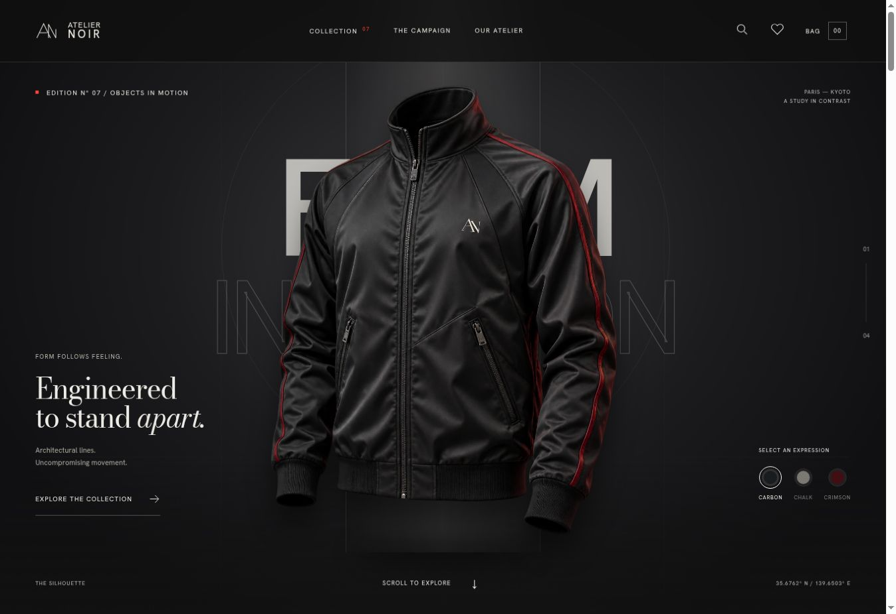

# Atelier Noir — Form in Motion

A cinematic menswear storefront with a complete browsing, bag, and checkout experience. Architectural typography, scroll-driven garment studies, and restrained motion extend into a searchable collection, dedicated product pages, and client services.

**[Live storefront](https://atelier-noir-motion.vercel.app/)** · **[Collection](https://atelier-noir-motion.vercel.app/catalog)** · **[Commerce setup guide](docs/commerce-setup.md)**



## Project status

The storefront and commerce integration are implemented. **Real ordering remains closed until the merchant connects and verifies the services, approves the catalog, enters actual stock, and publishes business and fulfilment details.** With no credentials, the collection, product pages, wishlist, and shopping bag work normally; checkout and contact clearly show their availability instead of simulating a payment or delivered message.

The six products, prices, specifications, and editorial imagery originate from the design concept and require merchant approval before sale. This repository does not create a payment account, provide merchandise, or fulfil orders.

## Features

- **Cinematic homepage:** Four scroll chapters, GSAP choreography, perspective motion, editorial campaign sections, and reduced-motion support.
- **Full catalog page:** Text search, category and size filters, price ranges, sorting, result counts, shareable filter URLs, and useful empty states.
- **Product pages:** Image zoom, descriptions, material and care information, size selection, related pieces, and saved favorites.
- **Persistent shopping bag:** Size-specific line items, quantity controls, removal, authoritative server-side pricing at checkout, and browser persistence.
- **Search everywhere:** Desktop header search, mobile search drawer, and live catalog results.
- **Hosted checkout:** Server-created Stripe Checkout sessions, delivery-country selection, explicit shipping fees, Stripe Tax, protected order receipts, and printable confirmations.
- **Order integrity:** Atomic inventory reservation, idempotent requests, signed webhooks, verified payment totals, and an authenticated reconciliation endpoint.
- **Client services:** Contact form, size guide, delivery and returns information, privacy notice, and configurable terms of sale.
- **Contact delivery:** Validation, honeypot, durable rate limits, database persistence, and Resend delivery to a fixed merchant inbox.
- **Responsive interface:** Dedicated mobile layouts, keyboard-accessible overlays, focus management, Escape dismissal, and semantic controls.

## Technology

| Layer | Technology |
| --- | --- |
| Application | React 19, React Router 7, Vite 7 |
| Motion | GSAP + ScrollTrigger, Framer Motion, Anime.js |
| Presentation | CSS, local Fontsource fonts, WebP imagery |
| API | Node.js Vercel Functions, native fetch |
| Database | Supabase Postgres, transactional SQL functions, restricted permissions |
| Payments | Stripe-hosted Checkout and signed webhooks |
| Contact | Resend |
| Tests | Node test runner and PGlite for the actual SQL migration |
| Hosting | Vercel |

Exact versions are recorded in `package-lock.json`. `src/GarmentScene.jsx` retains the earlier Three.js prototype, but it is not imported into production. The deployed garment uses detailed artwork with layered perspective animation, preserving the jacket consistently across devices. It is not a full 360-degree 3D asset.

## Local development

Requirements: Node.js **22.12+** or **24**, npm, and a modern browser.

```bash
git clone https://github.com/SobanHaroon/Atelier-nior.git
cd Atelier-nior
npm ci
cp .env.example .env.local
npm run dev
```

Open the URL printed by Vite. Set `STORE_URL` to that exact origin when testing POST endpoints. The default `.env.example` keeps commerce closed; browsing needs no external service credentials. The Vite development plugin serves the same API handlers used on Vercel.

| Command | Purpose |
| --- | --- |
| `npm ci` | Install the locked dependencies |
| `npm run dev` | Run the frontend and local API handlers |
| `npm test` | Run pricing, API, authorization, and database regression tests |
| `npm run build` | Create the production frontend in `dist/` |
| `npm run check` | Run tests and build |
| `npm run preview` | Inspect the static production frontend; does not serve API handlers |

Keep `.env.local` private. All payment, database, and email credentials are server-only: **never prefix them with `VITE_`**. The empty `.env.example` is the only environment file committed to this repository.

## Routes

| Route | Experience |
| --- | --- |
| `/` | Cinematic homepage |
| `/catalog` | Searchable, filterable collection |
| `/products/:id` | Product details and size selection |
| `/wishlist` | Saved pieces |
| `/cart` | Shopping bag |
| `/checkout` | Contact, destination, policy acceptance, and order review |
| `/checkout/success` | Server-verified payment status and receipt |
| `/contact` | Client services and contact form |
| `/size-guide` | General sizing guidance |
| `/delivery-returns` | Merchant delivery and returns policies |
| `/privacy` | Data handling information |
| `/terms` | Merchant terms and business identity |

Unknown paths show a recovery page. Vercel rewrites support direct navigation to application routes while preserving API and static-file requests.

## Commerce architecture

1. The browser submits product IDs, sizes, quantities, email, destination, and a checkout attempt ID. Client-supplied prices are ignored.
2. The API validates input, applies a durable rate limit, reads the shared server catalog, and reserves inventory in one database transaction.
3. The server creates a Stripe-hosted session using a stable idempotency key. Card and full address entry take place on Stripe.
4. Signed webhooks retrieve the current Stripe session and verify the order reference, subtotal, shipping, tax, currency, and final total before marking an order paid.
5. The confirmation page requires a private receipt token stored in the customer's browser session. A return URL alone never confirms payment.
6. Expired sessions release reserved stock once. Failed or uncertain provider requests are handled conservatively; an ambiguous response does not release inventory that may already have a payment session.

The database migration starts all variants at **zero stock**. Orders and messages are not accessible through anonymous or ordinary signed-in Supabase clients. The server service credential is required for these operations.

See [the setup guide](docs/commerce-setup.md) for schema installation, service configuration, webhook setup, payment testing, stock management, and operations.

## Repository structure

| Path | Responsibility |
| --- | --- |
| `src/main.jsx` | Routes, metadata, error boundary, and lazy homepage loading |
| `src/pages/` | Homepage, catalog, product, cart, checkout, contact, and information pages |
| `src/components/` | Header, footer, search, bag drawer, overlays, and product cards |
| `src/shop.jsx` | Shopping state, persistence, and public store configuration |
| `src/style.css` | Original editorial visual system and cinematic presentation |
| `src/commerce.css` | Commerce layouts, forms, and responsive behavior |
| `shared/catalog.js` | Product records, stable SKUs, USD prices, and variant definitions |
| `shared/cart.js` | Cart validation and server price calculation |
| `api/` | Vercel entry points for store, checkout, order, webhook, contact, and reconciliation |
| `server/` | Configuration, request guards, database, Stripe, and email adapters |
| `supabase/migrations/` | Tables, inventory transactions, rate limits, and permissions |
| `tests/` | Automated commerce, API, and database tests |
| `public/` | Images, icon, robots rules, and sitemap |
| `.env.example` | Empty server configuration template |
| `vercel.json` | Routing, function limits, and security headers |
| `docs/commerce-setup.md` | Launch and operations guide |

## Deployment

Deploy the **whole repository** to Vercel; uploading `dist/` alone will omit the server functions.

| Setting | Value |
| --- | --- |
| Framework | Vite |
| Root directory | Repository root |
| Install | `npm ci` |
| Build | `npm run build` |
| Output | `dist` |
| Node.js | 24.x |

The existing production project is `atelier-noir-motion`. Its public URL is [atelier-noir-motion.vercel.app](https://atelier-noir-motion.vercel.app/). Vercel's Git integration deploys this repository's `main` branch to production automatically. The commerce release was verified against its Git commit and the production deployment reported `READY`.

Configure server environment variables separately for preview and production. Redeploy after configuration changes. Keep test payment credentials and test inventory separate from live data.

## Customization

- Update catalog records in `shared/catalog.js`; keep IDs stable and update the inventory migration or live variant records when adding sizes or products.
- Replace product imagery in `public/images/` and adjust crop classes in the stylesheets.
- Modify homepage animation and chapter copy in `src/pages/Home.jsx`.
- Update the visual system in `src/style.css` and commerce layouts in `src/commerce.css`.
- Configure merchant identity, policies, destinations, and shipping through the server environment.
- Update the sitemap, metadata, and `STORE_URL` if the domain changes.

The homepage Carbon, Chalk, and Crimson selector changes the cinematic artwork treatment. The catalog's Technical Shell is the Carbon product; the other visual treatments do not imply purchasable variants.

## Validation and operational scope

The automated suite covers manipulated prices, invalid quantities, duplicate variants, launch gates, protected receipts, contact routing, webhook signatures, database access restrictions, reservation retries, stock rollback, overselling, and terminal order states. SQL tests execute the actual migration in PGlite; provider calls in API tests are mocked and do not charge cards or send email.

Desktop and mobile browsing, filtering, search, product selection, bag persistence, checkout layout, contact layout, and the cinematic artwork have been checked. A real end-to-end payment and email delivery test remains required after merchant services are connected.

The current adapter supports **USD card payments, one configured standard shipping rate, and configured destination countries**. There is no cash-on-delivery integration, multi-currency conversion, customer account area, or custom administration dashboard. Use the private Supabase dashboard for orders and stock, and Stripe for payment support and refunds. Fulfilment, shipment notifications, refund-related stock decisions, retention, and customer support remain merchant operations.

## Credits

Created for **DevOps Services**, based on the supplied menswear layout and cinematic reference. Editorial assets originate from that design. Confirm commercial rights and product accuracy before trading. Third-party libraries and fonts retain their own licenses.
